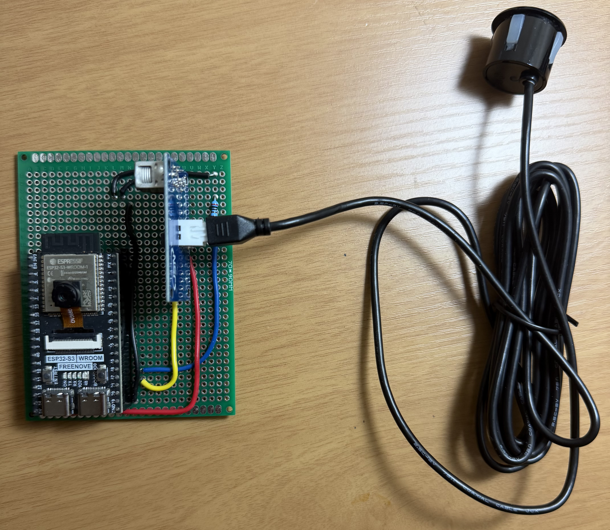
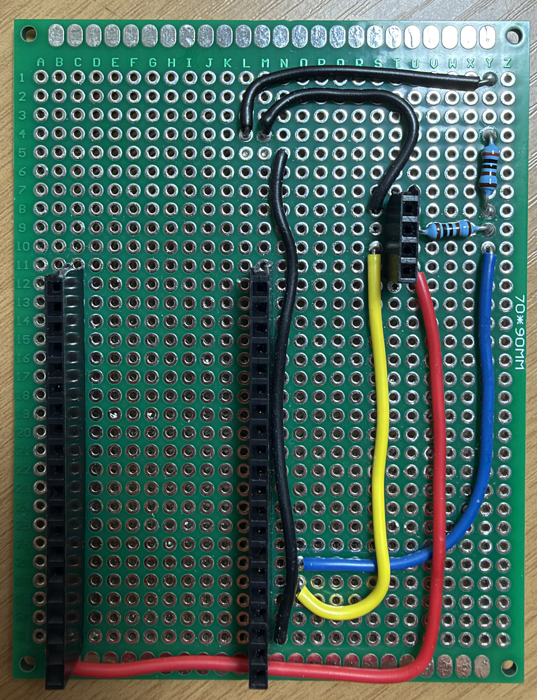
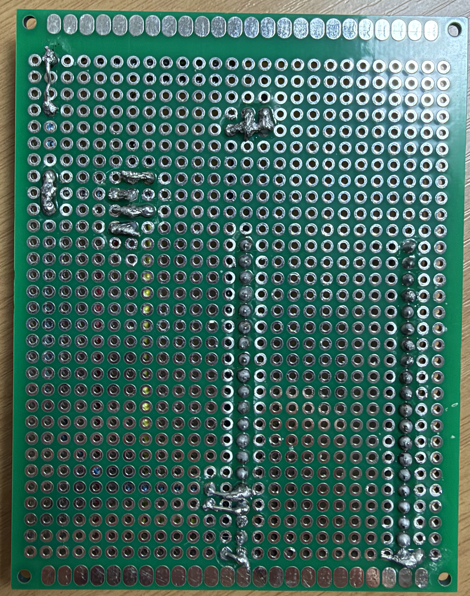
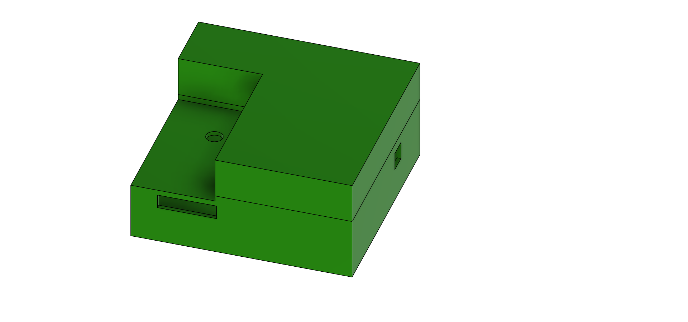
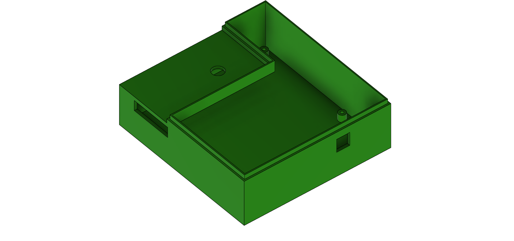
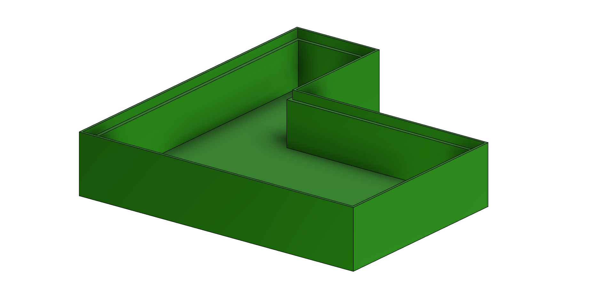
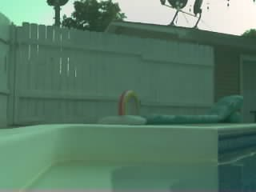

# ESP32-S3 IoT Pool Level Monitoring System

## Overview

This project is an IoT-based pool water level monitoring system developed using an ESP32-S3 with an integrated camera and a waterproof ultrasonic sensor. The system periodically measures the water level relative to a desired baseline, captures an image of the pool, and sends the results through Telegram over Wi-Fi.

I developed this project to provide my neighbor with a temporary, low-cost solution for her leaking pool. Instead of paying a expensive repair bill and closing the pool early for the season, I designed a system that allowed us to remotely monitor the pool's water level and determine when it needed to be refilled using a garden hose.

## Key Features

- Non-contact ultrasonic water level measurement
- Median filtering to reduce measurement outliers
- Calibrated water level readings in inches
- Automated Telegram notifications with image capture
- Timer-based deep sleep with a 15-minute interval
- Custom soldered perfboard with removable components
- Custom 3D-printed enclosure designed in Autodesk Fusion

## Hardware

| Component | Description |
|---|---|
| Freenove ESP32-S3-CAM | Microcontroller, camera, and Wi-Fi communication |
| JSN-SR04T | Waterproof ultrasonic sensor |
| Resistors | Voltage-level interfacing |
| Perfboard | Soldered circuit assembly |
| Female pin headers | Removable component connections |

## System Operation

1. Initialize the camera and capture an image of the pool.
2. Collect five valid ultrasonic measurements, subject to a maximum of 15 attempts.
3. Apply median filtering and a calibration offset based on the sensor's mounting position.
4. Connect to Wi-Fi and transmit the measurement and image through Telegram.
5. Enter deep sleep for 15 minutes before repeating the cycle.

The firmware also incorporates camera initialization retries, sensor timeouts, Wi-Fi connection timeouts, and camera frame buffer management to improve system reliability.

## Hardware Assembly

The circuit was assembled on a soldered perfboard using removable connections for the ESP32-S3-CAM and ultrasonic sensor module, allowing for easier replacement and troubleshooting.

| Assembled | Disassembled | Solder Connections |
|---|---|---|
|  |  |  |

## Enclosure Design

A custom two-piece enclosure was designed in Autodesk Fusion to house the electronic components.

| Assembled Enclosure | Base | Lid |
|---|---|---|
|  |  |  |

The original Fusion design and printable STL files are available in the [cad](cad/) directory.

## System Demonstration

| ESP32-S3-CAM Image Capture | Telegram Notification |
|---|---|
|  |  |

## Software Setup

**Requirements:**
- Arduino IDE
- ESP32 Arduino board package
- ArduinoJson
- UniversalTelegramBot

**Configuration:**

1. Download or clone the repository.
2. Open `firmware/firmware.ino` in Arduino IDE.
3. Copy `secrets.example.h` to `secrets.h` and enter your Wi-Fi and Telegram credentials.
4. Configure the ESP32-S3 board settings with PSRAM enabled.
5. Adjust the calibration offset for your sensor's mounting position.
6. Compile and upload the firmware.

## Acknowledgments

Camera configuration and pin definitions were adapted from Espressif's ESP32 Arduino camera example.
